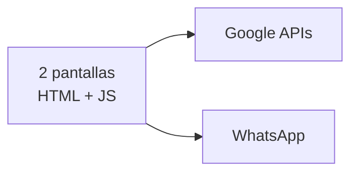

# Arquitectura · ubuntu

Generado leyendo el repo. **No editar a mano**: lo regenera el CI en cada commit.

Todo lo que figura acá está escrito en el código. Nada está inferido por un modelo de lenguaje: si algo no se puede probar leyendo el repo, no aparece.

## Las piezas

